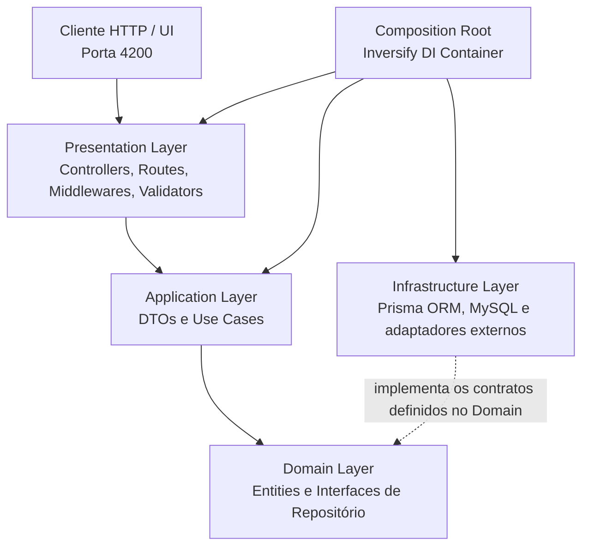

# NATIVE - Customer Management API

API REST desenvolvida em Node.js com TypeScript e Express, estruturada sob os princípios de **Clean Architecture** e **SOLID** para o gerenciamento de clientes da Native IP.

---

## 🛠️ Stack Tecnológica

- **Core / Runtime:** Node.js v26.5.0 (gerenciado via `.nvmrc`)
- **Linguagem:** TypeScript
- **Framework Web:** Express.js
- **ORM / Banco de Dados:** Prisma ORM + MySQL
- **Comunicação Real-time:** Socket.io (WebSocket)
- **Validação de Dados:** Zod
- **Qualidade de Código & Linting:** ESLint + Prettier
- **Arquitetura:** Clean Architecture + SOLID
- **Injeção de Dependências:** Inversify

---

## 🏗️ Arquitetura do Projeto

A API adota uma Clean Architecture desacoplada, separando
responsabilidades em camadas bem definidas e isolando as regras de
negócio de dependências de infraestrutura:



---

## 🌳 Estrutura de Pastas

<details>
<summary><b>📂 NATIVE.CustomerManagement.API/</b>
</summary>

- 📁 **`.github/`** — Workflows de CI/CD (GitHub Actions)
- 📁 **`.vscode/`** — Configurações e extensões recomendadas
- 📁 **`docker/`** — Configurações e scripts Docker
- 📁 **`docs/`** — Documentação complementar da API
- 📁 **`prisma/`** — Camada de Persistência e Infraestrutura
  - 📁 **`data/`**
    - 📁 **`customers/`** — Fontes de dados estáticas (`customers.json`)
  - 📁 **`migrations/`** — Histórico de migrações DDL do MySQL
  - 📁 **`models/`**
    - 📁 **`customers/`** — Modelos de entidade isolados (`customer.prisma`)
  - 📁 **`seed/`** — Scripts modulares de população de dados
    - 📁 **`common/`** — Classes base e contratos de seed (`base.seed.ts`)
    - 📁 **`customers/`** — Script de seed de clientes (`customer.seed.ts`)
    - 📄 `index.ts` — Orquestrador principal de seeds
  - 📄 `schema.prisma` — Configuração do cliente e datasource
  - 📄 `tsconfig.json` — Isolamento de compilação do TypeScript para a pasta Prisma
- 📁 **`src/`** — Código-fonte principal (Clean Architecture)
  - 📁 **`application/`**
    - 📁 **`common/dtos/`** — DTOs base compartilhados
    - 📁 **`customers/dtos/`** — DTOs específicos do domínio de clientes
    - 📁 **`customers/use-cases/`** — Casos de uso da aplicação (SRP)
  - 📁 **`domain/`**
    - 📁 **`common/`** — Entidades e contratos base (Entities, Repositories)
    - 📁 **`customers/`** — Contexto de domínio (Entities, Repositories)
  - 📁 **`infrastructure/`**
    - 📁 **`database/`** — Conexões de banco de dados
    - 📁 **`di/`** — Container e configuração da injeção de dependências (Inversify)
      - 📄 `container.ts` — Inicialização do container
      - 📁 **`modules/`** — Registro das dependências por módulo
        - 📄 `customers.module.ts` — Registro das dependências relacionadas a clientes
    - 📁 **`repositories/`** — Implementações concretas (Prisma)
    - 📁 **`utils/`** — Helpers e métodos facilitadores (`json-file-reader.ts`)
    - 📁 **`websocket/`** — Configuração Socket.io
  - 📁 **`presentation/`**
    - 📁 **`controllers/`** — Controladores HTTP
    - 📁 **`middlewares/`** — Middlewares globais (Auth, Erros)
    - 📁 **`routes/`** — Definição de rotas
    - 📁 **`validators/`** — Schemas de validação (Zod)
  - 📄 `server.ts` — Ponto de entrada da aplicação
- 📄 `.editorconfig` — Padronização de formatação do editor
- 📄 `.env` — Variáveis de ambiente locais (não versionado)
- 📄 `.env.example` — Modelo de variáveis de ambiente
- 📄 `.gitattributes` — Atributos de normalização de arquivos do Git
- 📄 `.gitignore` — Arquivos ignorados pelo controle de versão
- 📄 `.nvmrc` — Versão padronizada do Node.js
- 📄 `.prettierrc` — Regras de formatação de código do Prettier
- 📄 `docker-compose.yml` — Orquestração de containers Docker (MySQL)
- 📄 `eslint.config.mjs` — Configuração complementar do ESLint (ESM)
- 📄 `package-lock.json` — Registro de versões exatas das dependências npm
- 📄 `package.json` — Dependências e scripts do projeto
- 📄 `prisma.config.ts` — Configurações do Prisma ORM
- 📄 `README.md` — Documentação do repositório
- 📄 `tsconfig.json` — Configuração do compilador TypeScript

</details>

---

## 🚀 Pré-requisitos e Gestão de Versão (NVM & Node.js)

Para manter a consistência do ambiente entre todos os desenvolvedores e no pipeline de CI/CD, o projeto padroniza as versões do Node.js e do gerenciador de pacotes NPM.

- **Node.js:** `v26.5.0` (definido no arquivo `.nvmrc`)
- **NPM:** `v10.x` ou superior (gerenciado automaticamente pelo Node)
- **NVM (Node Version Manager):** Recomendado para alternar a versão do Node facilmente.

### Como instalar o NVM

[NVM Download](https://www.nvmnode.com/pt/guide/download.html)

### Como alternar para a versão correta do Node via NVM

**Linux / macOS / WSL:**

```bash
nvm use
```

_(Se a versão `26.5.0` não estiver instalada, rode `nvm install` primeiro.)_

**Windows (`nvm-windows`):**

```cmd
nvm use 26.5.0
```

---

## ⚙️ Configuração do Ambiente

1. **Clonar o repositório e acessar a pasta da API:**

   ```bash
   git clone https://github.com/DiegoSantos18/NATIVE.CustomerManagement.API.git
   cd NATIVE.CustomerManagement.API
   ```

2. **Garantir a versão correta do Node.js:**

   ```bash
   nvm use
   ```

   _(No VS Code, você pode pressionar `Ctrl + Shift + P` → `Tasks: Run Task` → `Usar versão do Node (.nvmrc)`)._

3. **Instalar as dependências do projeto:**

   ```bash
   npm install
   ```

4. **Configurar as variáveis de ambiente:**

   Copie o arquivo `.env.example` para criar o arquivo `.env` local:

   ```bash
   cp .env.example .env
   ```

   _(No VS Code, você pode pressionar `Ctrl + Shift + P` →
   `Tasks: Run Task` → `Copiar .env.example para .env`)._

---

## 📜 Scripts Disponíveis

No arquivo `package.json`, estão configurados os seguintes scripts:

---

Comando Descrição

---

`npm run dev` Inicia o servidor de
desenvolvimento com _live-reload_
via `tsx`.

`npm run build` Compila os arquivos TypeScript
(`src/`) para JavaScript na pasta
`dist/`.

`npm run start` Executa a versão compilada da API
presente em `dist/server.js`.

`npm run prisma:db:validate` Valida a configuração e o schema do
Prisma.

`npm run prisma:db:generate` Gera o Prisma Client com base no
schema configurado.

`npm run prisma:db:seed` Executa o orquestrador de seeds
para popular a base de dados.

`npm run prisma:db:migrate` Cria e aplica novas migrações no
banco via Prisma.

`npm run prisma:db:reset` Apaga o banco, reaplica as
migrações do zero e executa o seed
automático.

`npm run prisma:db:studio` Abre a interface gráfica web do
Prisma Studio no navegador.

`npm run lint` Executa a verificação estática do
código com ESLint.

`npm run lint:fix` Corrige automaticamente os erros
identificados pelo ESLint.

`npm run format` Formata automaticamente os arquivos
TypeScript utilizando o Prettier.
-----------------------------------------------------------------------

---

## 🏃 Como Executar a Aplicação

### Modo Desenvolvimento

Para subir a API localmente com recarregamento automático a cada
alteração:

```bash
npm run dev
```

O servidor estará acessível em: `http://localhost:3000`

Endpoint de verificação de integridade: `http://localhost:3000/health`

### Endpoints disponíveis

---

Método Endpoint Descrição

---

`GET` `/health` Verifica a
disponibilidade da API.

`GET` `/customers/total-by-city` Retorna a quantidade de
clientes agrupada por
cidade.
----------------------------------------------------------------------------

**Exemplo de requisição:**

```http
GET http://localhost:3000/customers/total-by-city
```

A rota não exige parâmetros nem corpo na requisição. Em caso de sucesso,
retorna HTTP `200` com os dados agrupados por cidade.

### 🗄️ Banco de Dados e Seed

O projeto utiliza MySQL 8, executado localmente via Docker Compose.

Consulte o [Guia do Banco de Dados](docs/database.md) para instruções
sobre configuração do ambiente, inicialização do container, permissões
do Prisma Migrate e execução das migrations e seeds.

Para recriar o ambiente de banco de dados do zero e popular com os dados
iniciais do `customers.json`:

```bash
npm run prisma:db:reset
```

---

### Modo Produção (Compilado)

Para testar o fluxo completo de compilação e execução do código final:

```bash
npm run build
npm run start
```
