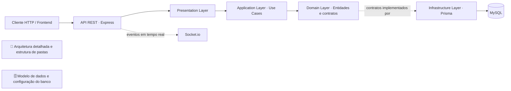

# NATIVE - Customer Management API

API REST desenvolvida em Node.js com TypeScript e Express, estruturada sob os princípios de **Clean Architecture** e **SOLID** para o gerenciamento de clientes da Native IP.

---

## 🛠️ Stack Tecnológica

- **Core / Runtime:** Node.js v26.5.0 (gerenciado via `.nvmrc`)
- **Linguagem:** TypeScript
- **Framework Web:** Express.js
- **ORM / Banco de Dados:** Prisma ORM + MySQL
- **Comunicação Real-time:** Socket.io (WebSocket)
- **Validação de Dados:** Zod
- **Qualidade de Código & Linting:** ESLint + Prettier
- **Testes:** Vitest
- **Arquitetura:** Clean Architecture + SOLID
- **Injeção de Dependências:** Inversify

---

## 🧭 Visão Geral da Arquitetura

Este diagrama resume o fluxo principal da API e conecta a documentação detalhada das camadas e do banco de dados.



> - [📐 Arquitetura detalhada, camadas e estrutura de pastas](docs/architecture.md)
> - [🗄️ Guia do banco de dados, migrations, seed e diagrama ER](docs/database.md)

---

## 🚀 Pré-requisitos e Gestão de Versão (NVM & Node.js)

Para manter a consistência do ambiente entre os desenvolvedores e no pipeline de CI/CD, o projeto padroniza a versão do Node.js.

- **Node.js:** `v26.5.0` (definido no arquivo `.nvmrc`)
- **NPM:** `v10.x` ou superior
- **NVM (Node Version Manager):** recomendado para alternar entre versões do Node.js.

### Como instalar o NVM

[NVM Download](https://www.nvmnode.com/pt/guide/download.html)

### Como alternar para a versão correta do Node via NVM

**Linux / macOS / WSL:**

```bash
nvm use
```

_(Se a versão `26.5.0` não estiver instalada, rode `nvm install` primeiro.)_

**Windows (`nvm-windows`):**

```cmd
nvm use 26.5.0
```

---

## ⚙️ Configuração do Ambiente

1. **Clonar o repositório e acessar a pasta da API:**

   ```bash
   git clone https://github.com/DiegoSantos18/NATIVE.CustomerManagement.API.git
   cd NATIVE.CustomerManagement.API
   ```

2. **Selecionar a versão do Node.js definida pelo projeto:**

   ```bash
   nvm use
   ```

3. **Instalar as dependências:**

   ```bash
   npm install
   ```

4. **Configurar as variáveis de ambiente:**

   Copie `.env.example` para `.env` e ajuste os valores locais conforme necessário:

   ```bash
   cp .env.example .env
   ```

   No Windows PowerShell, você também pode usar:

   ```powershell
   Copy-Item .env.example .env
   ```

---

## 📜 Scripts Disponíveis

| Comando                      | Descrição                                                                      |
| ---------------------------- | ------------------------------------------------------------------------------ |
| `npm run dev`                | Inicia o servidor de desenvolvimento com recarga automática via `tsx`.         |
| `npm run build`              | Compila o TypeScript para JavaScript na pasta de saída configurada.            |
| `npm run start`              | Executa a versão compilada da API.                                             |
| `npm run prisma:db:validate` | Valida a configuração e o schema do Prisma.                                    |
| `npm run prisma:db:generate` | Gera o Prisma Client.                                                          |
| `npm run prisma:db:seed`     | Executa os seeds para popular a base de dados.                                 |
| `npm run prisma:db:migrate`  | Cria e aplica migrations do banco via Prisma.                                  |
| `npm run prisma:db:reset`    | Recria o banco, reaplica as migrations e executa os seeds.                     |
| `npm run prisma:db:studio`   | Abre o Prisma Studio no navegador.                                             |
| `npm run lint`               | Executa a análise estática do código com ESLint.                               |
| `npm run lint:fix`           | Corrige automaticamente problemas de lint compatíveis com correção automática. |
| `npm run format`             | Formata os arquivos com Prettier.                                              |
| `npm test`                   | Executa os testes automatizados com Vitest.                                    |
| `npm run check:circular`     | Verifica dependências circulares no código-fonte com Madge.                    |
| `npm run check:all`          | Verificar se tudo acima esta OK!                                               |

---

## 🏃 Como Executar a Aplicação

### Modo Desenvolvimento

Inicie a API localmente com recarga automática:

```bash
npm run dev
```

Por padrão, a API fica disponível em `http://localhost:3000`.

### 🗄️ Banco de Dados

O projeto utiliza MySQL 8 via Docker Compose. Consulte o [Guia do Banco de Dados](docs/database.md) para configurar o ambiente, iniciar o container e executar migrations e seeds.

Para recriar o banco e carregar os dados iniciais:

```bash
npm run prisma:db:reset
```

> **Atenção:** esse comando apaga os dados existentes no banco configurado e recria a estrutura. Utilize-o somente quando quiser reinicializar o ambiente local.

---

## 🧪 Qualidade e Testes

Antes de enviar alterações, execute os testes automatizados e as verificações estáticas:

```bash
npm test
npm run lint
npx tsc --noEmit
npm run check:circular
```

O projeto utiliza Vitest para testes, ESLint para análise estática, TypeScript para verificação de tipos e Madge para identificar possíveis dependências circulares.
