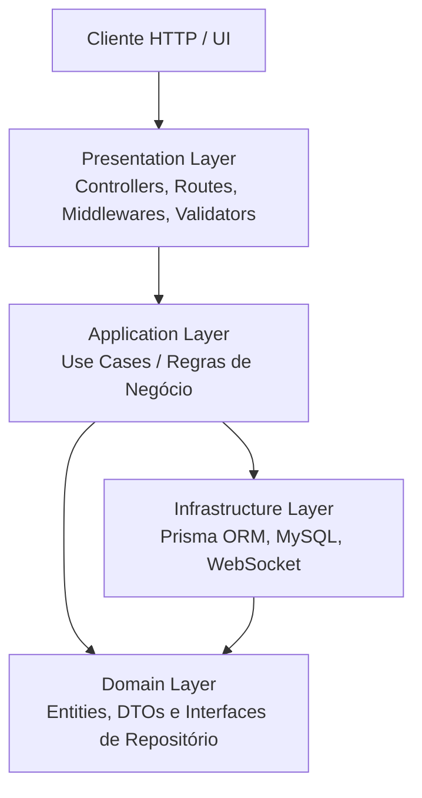

# NATIVE - Customer Management API

API REST desenvolvida em Node.js com TypeScript e Express, estruturada sob os princípios de **Clean Architecture** e **SOLID** para o gerenciamento de clientes da Native IP.

---

## 🛠️ Stack Tecnológica

- **Core / Runtime:** Node.js v26.5.0 (gerenciado via `.nvmrc`)
- **Linguagem:** TypeScript
- **Framework Web:** Express.js
- **ORM / Banco de Dados:** Prisma ORM + MySQL
- **Comunicação Real-time:** Socket.io (WebSocket)
- **Validação de Dados:** Zod
- **Qualidade de Código & Linting:** ESLint + Prettier
- **Arquitetura:** Clean Architecture + SOLID

---

## 🏗️ Arquitetura do Projeto

A API adota uma Clean Architecture desacoplada, separando responsabilidades em camadas bem definidas e isolando as regras de negócio de dependências de infraestrutura:



---

## 📂 Estrutura de Pastas

```text
NATIVE.CustomerManagement.API/
├── .github/                      # Workflows de CI/CD (GitHub Actions)
├── .vscode/                      # Configurações, Tasks e Extensões recomendadas
├── src/
│   ├── application/              # Camada de Aplicação (Regras de Negócio)
│   │   └── use-cases/            # Casos de uso atômicos (SRP)
│   ├── domain/                   # Camada de Domínio (Núcleo da Aplicação)
│   │   ├── dtos/                 # Objetos de Transferência de Dados
│   │   ├── entities/             # Entidades puras do negócio
│   │   └── repositories/         # Contratos e Interfaces dos repositórios
│   ├── infrastructure/           # Camada de Infraestrutura
│   │   ├── database/             # Instância e conexões de banco de dados
│   │   ├── repositories/         # Implementações concretas (Prisma ORM)
│   │   └── websocket/            # Configuração e emissão de eventos Socket.io
│   ├── presentation/             # Camada de Apresentação (Interface HTTP)
│   │   ├── controllers/          # Controladores HTTP
│   │   ├── middlewares/          # Middlewares globais (Tratamento de erros, Auth)
│   │   ├── routes/               # Definição e agrupamento de rotas
│   │   └── validators/           # Schemas de validação de entrada (Zod)
│   └── server.ts                 # Ponto de entrada e inicialização da aplicação
├── .env                          # Variáveis de ambiente locais (não versionado)
├── .env.example                  # Modelo de variáveis de ambiente
├── .eslintrc.json                # Regras de linting do ESLint
├── .gitignore                    # Arquivos ignorados pelo Git
├── .nvmrc                        # Versão padronizada do Node.js (26.5.0)
├── .prettierrc                   # Regras de formatação de código do Prettier
├── package.json                  # Dependências e scripts do projeto
├── README.md                     # Documentação da API
└── tsconfig.json                 # Configuração do compilador TypeScript
```

---

## 🚀 Pré-requisitos e Gestão de Versão (NVM & Node.js)

Para manter a consistência do ambiente entre todos os desenvolvedores e no pipeline de CI/CD, o projeto padroniza as versões do Node.js e do gerenciador de pacotes NPM.

- **Node.js**: `v26.5.0` (definido no arquivo `.nvmrc`)
- **NPM**: `v10.x` ou superior (gerenciado automaticamente pelo Node)
- **NVM (Node Version Manager)**: Recomendado para alternar a versão do Node facilmente.

### Como instalar o NVM:

`https://www.nvmnode.com/pt/guide/download.html`

### Como alternar para a versão correta do Node via NVM:

**Linux / macOS / WSL:**

```bash
nvm use
```

_(Se a versão `26.5.0` não estiver instalada, rode `nvm install` primeiro)._

**Windows (`nvm-windows`):**

```cmd
nvm use 26.5.0
```

---

## ⚙️ Configuração do Ambiente

1. **Clonar o repositório e acessar a pasta da API:**

   ```bash
   git clone https://github.com/DiegoSantos18/NATIVE.CustomerManagement.API.git
   cd NATIVE.CustomerManagement.API
   ```

2. **Garantir a versão correta do Node.js:**

   ```bash
   nvm use
   ```

   _(No VS Code, você pode pressionar `Ctrl + Shift + P` -> `Tasks: Run Task` -> `Usar versão do Node (.nvmrc)`)._

3. **Instalar as dependências do projeto:**

   ```bash
   npm install
   ```

4. **Configurar as Variáveis de Ambiente:**
   Copie o arquivo `.env.example` para criar o arquivo `.env` local:
   ```bash
   cp .env.example .env
   ```
   _(No VS Code, você pode pressionar `Ctrl + Shift + P` -> `Tasks: Run Task` -> `Copiar .env.example para .env`)._

---

## 📜 Scripts Disponíveis

No arquivo `package.json`, estão configurados os seguintes scripts:

| Comando            | Descrição                                                                 |
| :----------------- | :------------------------------------------------------------------------ |
| `npm run dev`      | Inicia o servidor de desenvolvimento com _live-reload_ via `tsx`.         |
| `npm run build`    | Compila os arquivos TypeScript (`src/`) para JavaScript na pasta `dist/`. |
| `npm run start`    | Executa a versão compilada da API presente em `dist/server.js`.           |
| `npm run lint`     | Executa a verificação estática do código com ESLint.                      |
| `npm run lint:fix` | Corrige automaticamente os erros identificados pelo ESLint.               |
| `npm run format`   | Formata automaticamente os arquivos TypeScript utilizando o Prettier.     |

---

## 🏃 Como Executar a Aplicação

### Modo Desenvolvimento

Para subir a API localmente com recarregamento automático a cada alteração:

```bash
npm run dev
```

O servidor estará acessível em: `http://localhost:3000`
Endpoint de verificação de integridade: `http://localhost:3000/health`

### Modo Produção (Compilado)

Para testar o fluxo completo de compilação e execução do código final:

```bash
npm run build
npm run start
```
