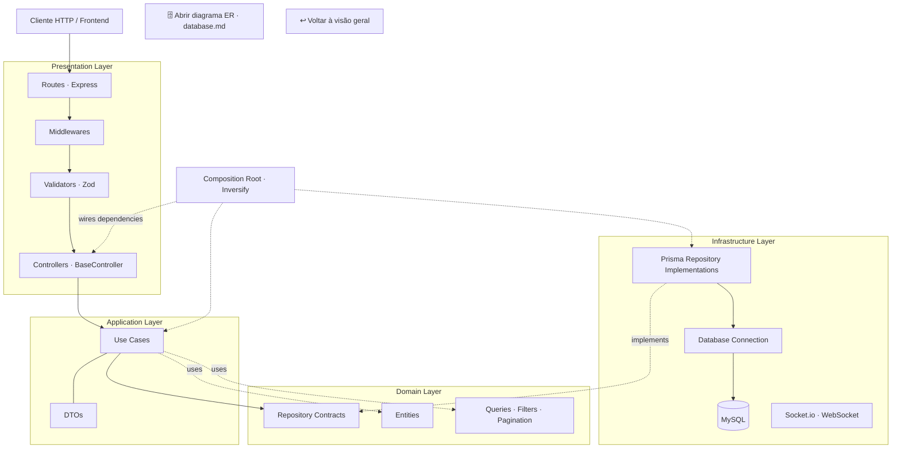

# 📐 Arquitetura da API

[← Voltar ao README / visão geral](../README.md) · [🗄️ Banco de dados e diagrama ER](./database.md#modelo-de-dados)

## 🏗️ Arquitetura em Camadas

A API segue os princípios de Clean Architecture: a camada de apresentação recebe e valida as requisições; a aplicação coordena os casos de uso; o domínio define conceitos e contratos; e a infraestrutura fornece implementações técnicas.

[🗄️ Abrir diretamente o diagrama ER do banco de dados](./database.md#modelo-de-dados)

### Fluxo da camada Presentation

1. **Routes:** mapeiam o método e o caminho HTTP para o handler correspondente.
2. **Middlewares:** executam tratamentos transversais configurados na aplicação.
3. **Validators (Zod):** validam os parâmetros e dados de entrada antes de chegarem ao controller.
4. **Controllers:** adaptam a requisição HTTP para a chamada do caso de uso e formatam a resposta por meio da classe base (`BaseController`).

> O diagrama representa responsabilidades arquiteturais. A ordem exata de execução depende de como os middlewares são registrados nas rotas da aplicação.

---

## 🌳 Estrutura de Pastas

A estrutura abaixo destaca os diretórios e responsabilidades por camada. Ela deve ser mantida alinhada à estrutura real do repositório.

<b>📂 NATIVE.CustomerManagement.API/</b>

- 📁 **`.github/`** — Workflows de CI/CD (GitHub Actions)
- 📁 **`.vscode/`** — Configurações e extensões recomendadas
- 📁 **`docker/`** — Configurações e scripts Docker
- 📁 **`docs/`** — Documentação complementar
  - 📄 `architecture.md` — Arquitetura em camadas e estrutura de pastas
  - 📄 `database.md` — Configuração do MySQL, migrations, seed e diagrama ER
- 📁 **`prisma/`** — Schema, migrations e seeds
  - 📁 `data/customers/` — Dados estáticos de clientes
  - 📁 `migrations/` — Histórico de migrações
  - 📁 `models/customers/` — Modelo Prisma de clientes
  - 📁 `seed/` — Scripts de população de dados
  - 📄 `schema.prisma` — Schema principal do Prisma
- 📁 **`src/`** — Código-fonte da API
  - 📄 `server.ts` — Inicialização do servidor
  - 📁 **`presentation/`** — Entrada HTTP
    - 📁 `routes/` — Rotas Express
    - 📁 `middlewares/` — Middlewares
    - 📁 `validators/` — Validação com Zod
    - 📁 `controllers/` — Controllers e `BaseController`
  - 📁 **`application/`** — Casos de uso e DTOs
    - 📁 `common/dtos/` — DTOs compartilhados
    - 📁 `customers/dtos/` — DTOs de clientes
    - 📁 `customers/use-cases/` — Casos de uso de clientes
  - 📁 **`domain/`** — Entidades, consultas e contratos
    - 📁 `common/entities/` — Tipos base de entidades
    - 📁 `common/queries/` — Tipos de consulta compartilhados
    - 📁 `common/repositories/` — Contratos base de repositório
    - 📁 `customers/entities/` — Entidade de cliente
    - 📁 `customers/queries/` — Filtros e paginação de clientes
    - 📁 `customers/repositories/` — Contrato do repositório de clientes
  - 📁 **`infrastructure/`** — Implementações técnicas
    - 📁 `database/` — Conexão e configuração do banco
    - 📁 `di/` — Injeção de dependências com Inversify
    - 📁 `repositories/` — Implementações concretas com Prisma
    - 📁 `utils/` — Utilitários compartilhados
    - 📁 `websocket/` — Configuração do Socket.io
- 📄 `.env.example` — Modelo de variáveis de ambiente
- 📄 `docker-compose.yml` — Orquestração do MySQL
- 📄 `package.json` — Dependências e scripts
- 📄 `prisma.config.ts` — Configuração do Prisma
- 📄 `tsconfig.json` — Configuração TypeScript

---

## 🔗 Documentação relacionada

- [README — visão geral e diagrama geral](../README.md)
- [Guia do banco de dados — configuração e modelo ER](./database.md#modelo-de-dados)
