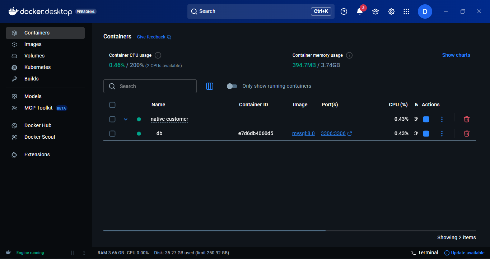
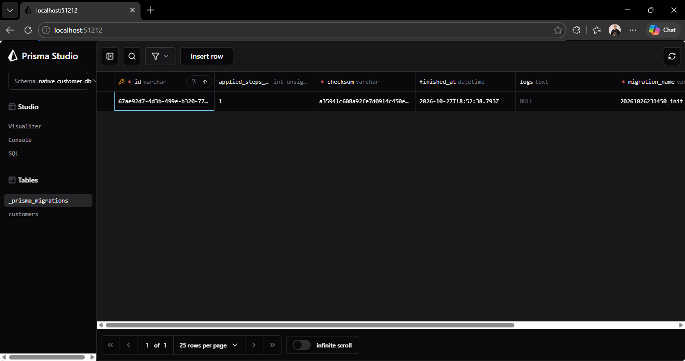
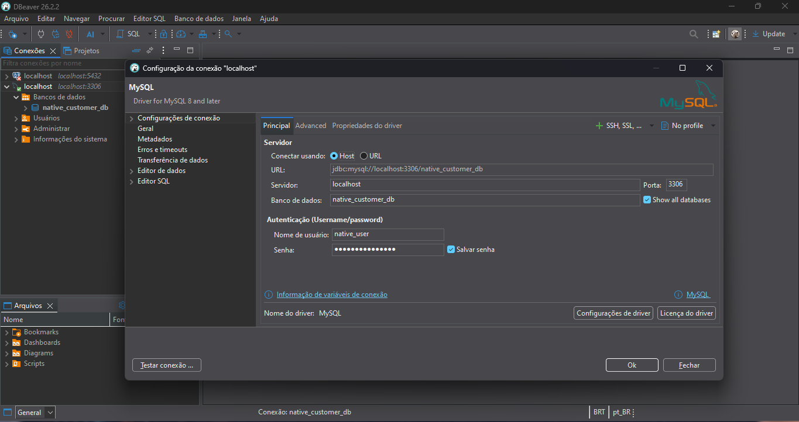
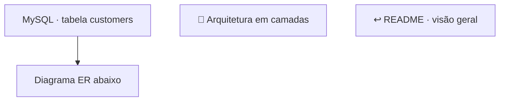
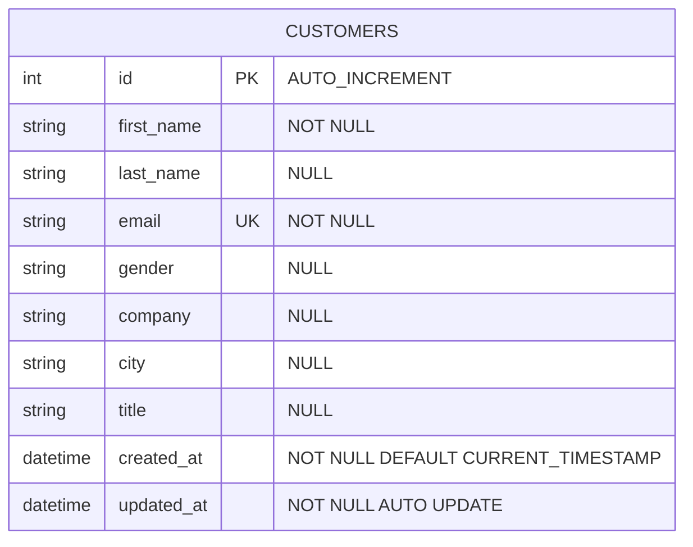

# 🗄️ Guia de Configuração do Banco de Dados (MySQL)

Este documento descreve como configurar, executar e gerenciar o ambiente MySQL local da API **Native Customer Management**, utilizando Docker Compose.

[← README / visão geral](../README.md) · [📐 Arquitetura em camadas](./architecture.md)

---

## 📋 Pré-requisitos

- [Docker](https://www.docker.com/) e [Docker Compose](../docker-compose.yml) instalados e em execução na sua máquina.

**Docker Desktop**



- Um cliente de banco de dados. Recomenda-se o **[DBeaver](https://dbeaver.io/download/)** ou a extensão **[Database Client](https://database-client.com/)** no VS Code (consulte as [Sugestões de Extensões](../.vscode/extensions.json)), mas você pode utilizar outra ferramenta de sua preferência.

**Prisma Studio**


Abre o Prisma Studio no navegador ([localhost:51212](http://localhost:51212/))

```bash
npm run prisma:db:studio
```

**DBeaver**



Configure a conexão e baixe os drivers, caso solicitado.


**Observação:** se ocorrer o erro `Public Key Retrieval is not allowed` ao testar a conexão, altere `allowPublicKeyRetrieval` para `true`. Quando a conexão não utiliza SSL — como no caso de `localhost` no Docker —, o driver JDBC do MySQL no DBeaver pode bloquear a busca automática da chave pública RSA do servidor.

**Database Client**


Por ser integrado ao VS Code, geralmente não é necessário instalar outra ferramenta.

---

## ⚙️ Configuração das Variáveis de Ambiente

Antes de iniciar o container, confirme que o arquivo `.env` na raiz da API está configurado com base no `.env.example`.

Exemplo de configuração utilizada:

```env
NODE_ENV=development
PORT=3000

# Configurações do MySQL (docker-compose)
DB=mysql
DB_HOST=localhost
DB_PORT=3306
DB_NAME=native_customer_db
DB_ROOT_PASSWORD=root
DB_USER=root
DB_PASSWORD=root

# String de conexão (Prisma ORM)
DATABASE_URL="${DB}://${DB_USER}:${DB_PASSWORD}@${DB_HOST}:${DB_PORT}/${DB_NAME}"
```

---

## 🐳 Inicialização do Banco de Dados

Após configurar o `.env`, execute na raiz do repositório:

```bash
docker compose up -d
```

Como alternativa, utilize a extensão de containers do VS Code, disponível também nas [Sugestões de Extensões](../.vscode/extensions.json).


---

<a id="modelo-de-dados"></a>

## 🧩 Modelo de Dados

O banco utiliza a tabela `customers`, definida pelo modelo `Customer` no Prisma. O diagrama abaixo representa o schema atual; atualize-o quando houver alterações em `prisma/schema.prisma` ou nos modelos importados pelo schema principal.





### Observações sobre o modelo

- **Chave primária:** `id`, inteiro autoincrementável.
- **Unicidade:** `email` possui restrição `UNIQUE`.
- **Campos opcionais:** `last_name`, `gender`, `company`, `city` e `title` aceitam `NULL`.
- **Datas de auditoria:** `created_at` recebe a data/hora de criação por padrão; `updated_at` é atualizado pelo Prisma nas atualizações.
- **Nomenclatura:** os campos `firstName`, `lastName`, `createdAt` e `updatedAt` no Prisma são mapeados para `first_name`, `last_name`, `created_at` e `updated_at` no MySQL.
- **Relacionamentos:** o modelo atual não possui chaves estrangeiras nem relacionamentos com outras tabelas.

---

## 🔄 Migrations e Seed

O schema do Prisma é a referência para a estrutura de dados. Para validar, gerar o Prisma Client, aplicar migrations e popular o banco, consulte os comandos disponíveis no `package.json` e a seção [Scripts Disponíveis](../README.md#-scripts-disponíveis) do README.

> **Importante:** mantenha as migrations versionadas e evite alterar manualmente o banco sem refletir a mudança no schema e nas migrations do projeto.

---

[← README / visão geral](../README.md) · [📐 Arquitetura em camadas](./architecture.md)

---

## 🔗 Documentação relacionada

- [README — visão geral e diagrama geral](../README.md)
- [Arquitetura — camadas e estrutura de pastas](./architecture.md)
