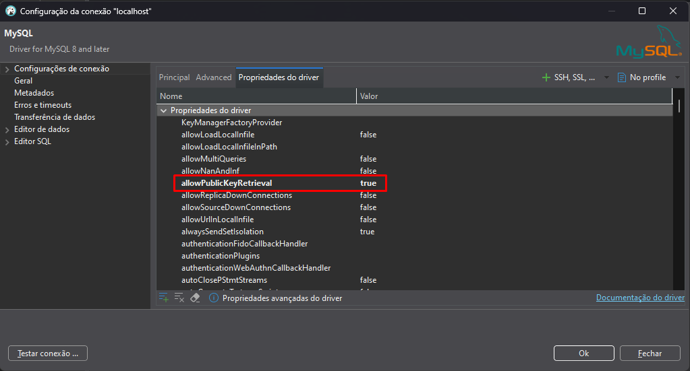
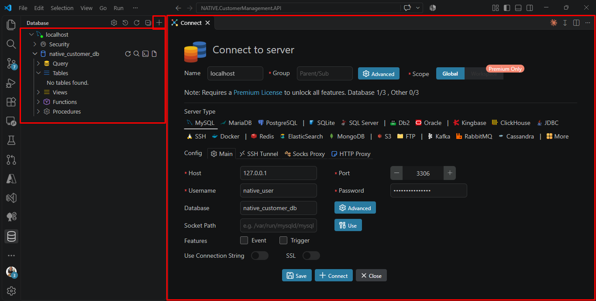
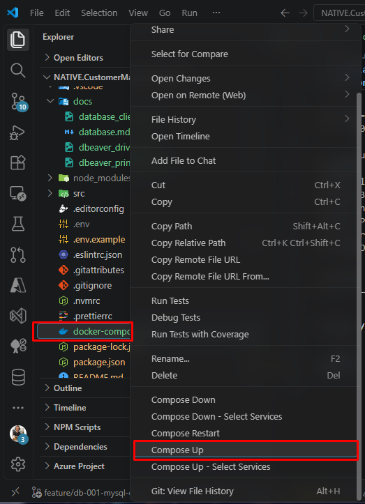

# 🗄️ Guia de Configuração do Banco de Dados (MySQL)

Este documento descreve como configurar, rodar e gerenciar o ambiente de banco de dados MySQL local para a API do projeto **Native Customer Management**, utilizando Docker Compose e Prisma ORM.

---

## 📋 Pré-requisitos

- [Docker](https://www.docker.com/) e [Docker Compose](../docker-compose.yml) instalados e em execução na sua máquina.

**Docker Desktop**


- Um cliente de banco de dados (recomenda-se o **[DBeaver](https://dbeaver.io/download/)** ou a extensão **[Database Client](https://database-client.com/)** no VS Code; verifique a seção [Sugestões de Extensões](../.vscode/extensions.json)) ou utilize algum outro de sua preferência.

**DBeaver**


Configure a conexão e baixe os drivers, caso solicitado.



**Observação:** se ocorrer o erro `Public Key Retrieval is not allowed` ao testar a conexão, altere `allowPublicKeyRetrieval` para `true`. Por padrão, quando a conexão não utiliza SSL (como no caso do localhost no Docker), o driver JDBC do MySQL no DBeaver bloqueia a busca automática da chave pública RSA do servidor para proteger a senha.

**Database Client**



Geralmente, não há problemas para conectar. Por ser integrado ao VS Code, não é necessário instalar outra ferramenta.

---

## ⚙️ Configuração das Variáveis de Ambiente

Antes de subir o container, certifique-se de que o arquivo `.env`, na raiz da API, esteja configurado com base no `.env.example`.

Exemplo de configuração utilizada:

```env
NODE_ENV=development
PORT=3000

# Configurações do MySQL (docker-compose)
DB=mysql
DB_HOST=localhost
DB_PORT=3306
DB_NAME=native_customer_db
DB_ROOT_PASSWORD=root
DB_USER=native_user
DB_PASSWORD=native_password

# String de Conexão (Prisma ORM)
DATABASE_URL="${DB}://${DB_USER}:${DB_PASSWORD}@${DB_HOST}:${DB_PORT}/${DB_NAME}"
```

Os valores apresentados são destinados ao ambiente local de desenvolvimento. Não utilize essas credenciais em produção.

---

## 🐳 Inicialização do MySQL

Após configurar o `.env`, suba o container Docker executando o comando na raiz do projeto:

```bash
docker compose up -d
```

Para consultar outros comandos, acesse a [documentação do Docker Compose](https://docs.docker.com/compose/).

**Alternativamente**, utilize o atalho da extensão, disponível também em [Sugestões de Extensões](../.vscode/extensions.json).



Para verificar se o container está em execução:

```bash
docker compose ps
```

Para consultar os logs do MySQL:

```bash
docker compose logs mysql
```

## 💾 Persistência dos Dados

O banco utiliza o volume Docker `db-data` para persistir os dados, mesmo que o container seja parado ou removido.

Para parar e remover os containers sem apagar o volume:

```bash
docker compose down
```

**Atenção:** o comando abaixo também remove os volumes declarados no Compose e, consequentemente, apaga os dados locais persistidos:

```bash
docker compose down -v
```

Utilize-o somente quando quiser recriar o ambiente do banco do zero.

## 🔐 Permissões do Prisma Migrate

O Prisma Migrate utiliza um banco shadow temporário durante a execução de `prisma migrate dev`. Esse banco auxilia na reconstrução do histórico de migrations e na identificação de divergências no esquema.

Neste projeto, não mantemos um banco shadow dedicado. O Prisma deve criar e remover automaticamente seu banco temporário durante o processo de desenvolvimento.

Para isso, o usuário configurado em `DB_USER` precisa ter as permissões necessárias para criar e remover o banco temporário.

O projeto utiliza o script de inicialização:

`docker/scripts/01-grant-access-root-migration.sh`

Esse script deve estar montado pelo `docker-compose.yml` no diretório `/docker-entrypoint-initdb.d/` do container MySQL.

**Importante:** os scripts desse diretório são executados automaticamente somente quando o MySQL inicializa um diretório de dados novo. Se o volume `db-data` já estiver inicializado, modificar o script não reaplica as permissões. Nesse caso, elas devem ser concedidas manualmente ao usuário existente.

A configuração de permissões globais simplifica o ambiente local, mas amplia os privilégios do usuário MySQL. Ela deve ser utilizada apenas no ambiente de desenvolvimento deste desafio, não em produção.

## 🧱 Migrations e Seeds do Prisma

Após iniciar o banco e garantir as permissões necessárias, valide o schema e gere o Prisma Client:

```bash
npm run prisma:db:validate
npm run prisma:db:generate
```

A validação verifica a configuração e o schema do Prisma. A geração atualiza o Prisma Client com base nos modelos reconhecidos pelo projeto.

Após essas etapas, execute a migration inicial:

```bash
npm run prisma:db:migrate
```

Para popular a base de dados utilizando o ficheiro estático `customers.json` através do nosso orquestrador modular de seeds, execute:

```bash
npm run prisma:db:seed
```

### Reset Completo do Banco (Migrations + Seed)

Se precisar limpar o banco inteiramente, rodar as migrações do zero e executar o seed de clientes de forma automatizada, utilize:

```bash
npm run prisma:db:reset
```

**Atenção:** o reset apaga os dados existentes e recria a estrutura do banco. Utilize-o somente quando realmente precisar reinicializar o ambiente.

O Prisma mantém o histórico das migrations na tabela `prisma_migrations`, dentro do banco principal `native_customer_db`.

---

## 🔎 Verificação das Permissões

Para conferir as permissões do usuário MySQL no ambiente Docker, execute:

```bash
docker compose exec mysql mysql -uroot -p -e "SHOW GRANTS FOR 'native_user'@'%';"
```

Digite a senha configurada em `DB_ROOT_PASSWORD` quando solicitado.

Verifique se o resultado contém as permissões necessárias para el Prisma Migrate criar e remover o banco temporário.

## 🔌 Conexão com o Banco de Dados

Para conectar pelo DBeaver ou Database Client, utilize os dados configurados no `.env`:

| Campo          | Valor                  |
| -------------- | ---------------------- |
| Host           | `localhost`            |
| Porta          | `3306`                 |
| Banco de dados | `native_customer_db`   |
| Usuário        | Valor de `DB_USER`     |
| Senha          | Valor de `DB_PASSWORD` |

O banco shadow temporário utilizado pelo Prisma não é o banco de conexão da aplicação. A API deve utilizar somente a `DATABASE_URL` do banco principal.
